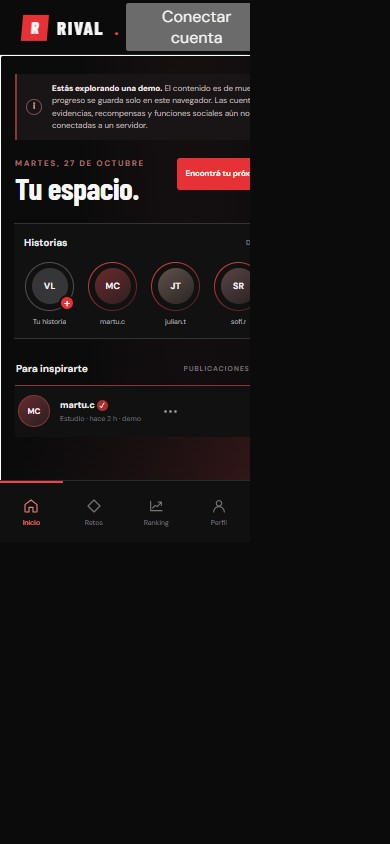
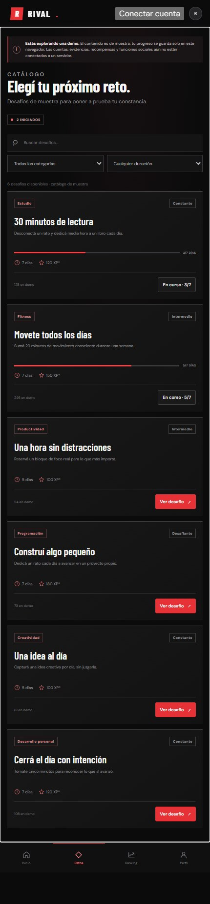

# RIVAL

**La única competencia es con quien eras ayer.**

RIVAL es una plataforma social de desafíos personales y competencia saludable, diseñada primero para teléfonos. Combina retos, progreso y comunidad en una experiencia oscura, directa y enfocada en la constancia. La interfaz se adapta también a pantallas de escritorio.

## La experiencia móvil

### Inicio y actividad



### Explorar desafíos



## Qué incluye

- **Inicio social:** historias de muestra, publicaciones de actividad y accesos rápidos.
- **Desafíos:** catálogo por categoría y duración, dificultad, progreso y recompensas ilustrativas.
- **Ranking y perfiles:** secciones de navegación para consultar la clasificación y el perfil.
- **Publicaciones con Supabase:** las personas autenticadas pueden compartir texto e imágenes públicas, opcionalmente vinculadas a un desafío.
- **Demo local:** permite recorrer la interfaz sin crear una cuenta. El contenido es de muestra y el estado de demostración se guarda en el navegador; no representa actividad compartida ni persistencia en un servidor.
- **Integración con Supabase:** el cliente y el esquema de base de datos habilitan autenticación, datos persistentes, almacenamiento privado y funciones sociales cuando se configuran.

## Tecnologías

- JavaScript con módulos nativos.
- HTML y CSS responsive.
- [Vite](https://vite.dev/) para desarrollo y compilación.
- [Supabase](https://supabase.com/) para autenticación, PostgreSQL, políticas RLS y almacenamiento cuando se conecta un proyecto.

## Empezar

Requiere Node.js 20.19+ o 22.12+.

```sh
npm install
npm run dev
```

Abrí la URL local que muestra Vite. La aplicación funciona en modo demo sin configurar credenciales.

### Compilar

```sh
npm run build
npm run preview
```

## Conectar Supabase

1. Copiá `.env.example` a `.env`.
2. Completá `VITE_SUPABASE_URL` y `VITE_SUPABASE_PUBLISHABLE_KEY` con los datos públicos de tu proyecto Supabase.
3. En el editor SQL de Supabase, aplicá las migraciones de `supabase/migrations/` en orden cronológico. Para una base que ya tiene el esquema inicial, aplicá solo las migraciones posteriores pendientes; no vuelvas a ejecutar la inicial.
4. En **Authentication → URL Configuration**, configurá las URL locales y de producción permitidas, incluidas las URL de redirección para recuperación de contraseña.
5. Iniciá o reiniciá `npm run dev`.

El esquema activa RLS y protege el acceso a los datos y las evidencias. La clave `publishable` puede usarse en el cliente; **no** coloques claves `secret` o `service_role` en archivos frontend ni las publiques. El archivo `.env` está excluido de Git.

### Funciones disponibles con Supabase configurado

- Registro, inicio y cierre de sesión; confirmación por correo y recuperación/actualización de contraseña.
- Lectura de desafíos activos, publicaciones visibles, perfil, ranking global, XP validado e insignias.
- Participación y abandono de desafíos, además del registro de días para retos que no requieren evidencia.
- Envío de evidencias privadas JPG, PNG, WebP, MP4 o PDF (hasta 20 MB) para revisión.
- Me gusta, publicaciones guardadas, seguimientos y comentarios, sujetos a las políticas de acceso de la base de datos.
- Creación de publicaciones públicas con texto, imagen JPG, PNG o WebP (hasta 10 MB) y vínculo opcional a un desafío activo.

Las recompensas sujetas a evidencia dependen de la aprobación de una persona revisora autorizada. El esquema permite esa revisión, pero todavía no hay una interfaz de administración de revisores.

## Estado del proyecto

RIVAL está en desarrollo. Sin Supabase, las cuentas, publicaciones y estadísticas de la demo no son datos reales ni se sincronizan entre dispositivos. Aún falta conectar la creación de desafíos, las historias, las notificaciones y los filtros avanzados del ranking (por región, período o categoría).

## Estructura

```text
.
├── app.js
├── index.html
├── styles.css
├── supabase.js
├── .env.example
├── package.json
├── docs/
│   └── images/
│       ├── inicio-mobile.jpg
│       └── desafios-mobile.jpg
└── supabase/
    └── migrations/
        ├── 20261027010000_initial_rival_schema.sql
        └── 20261027020000_fix_anonymous_post_visibility_policy.sql
```

## Verificación

```sh
npm run build
```
